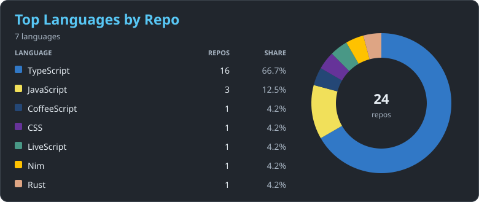
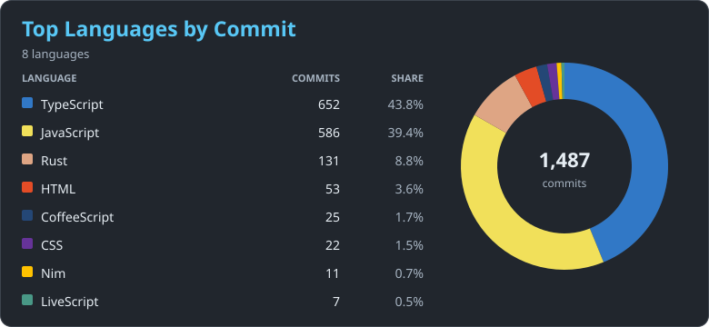
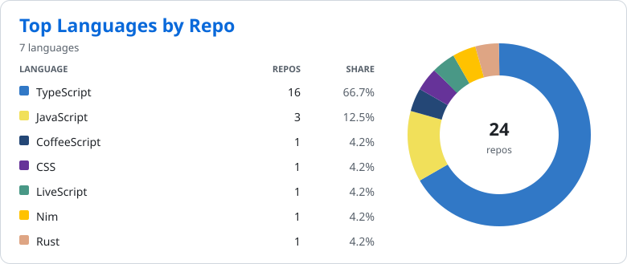
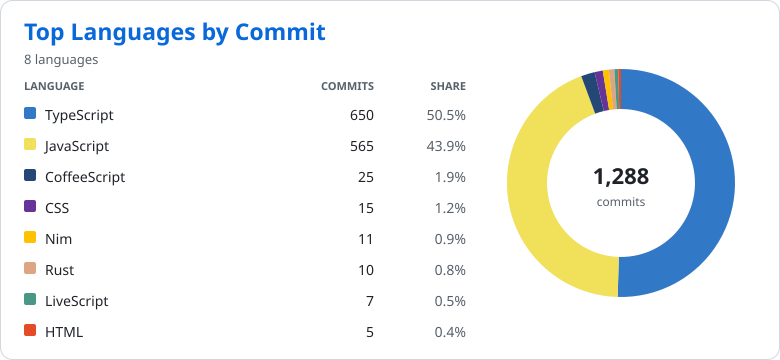

# Generated profile cards

Browse the cards from the latest generation and choose a style. Paths below are relative to this output directory.

To embed a card in your repository-root README, prefix its path with your configured output directory (for example, `./profile-card-output/dark/languages-by-repo.svg` when using the default).

Only cards generated during the latest run are listed. Older SVG files may still remain in this directory.

## Dark

### Top Languages by Repo · Donut

[Open SVG](./dark/languages-by-repo.svg) · `./dark/languages-by-repo.svg`

### Top Languages by Commit · Donut

[Open SVG](./dark/languages-by-commit.svg) · `./dark/languages-by-commit.svg`

## Light

### Top Languages by Repo · Donut

[Open SVG](./light/languages-by-repo.svg) · `./light/languages-by-repo.svg`

### Top Languages by Commit · Donut

[Open SVG](./light/languages-by-commit.svg) · `./light/languages-by-commit.svg`

